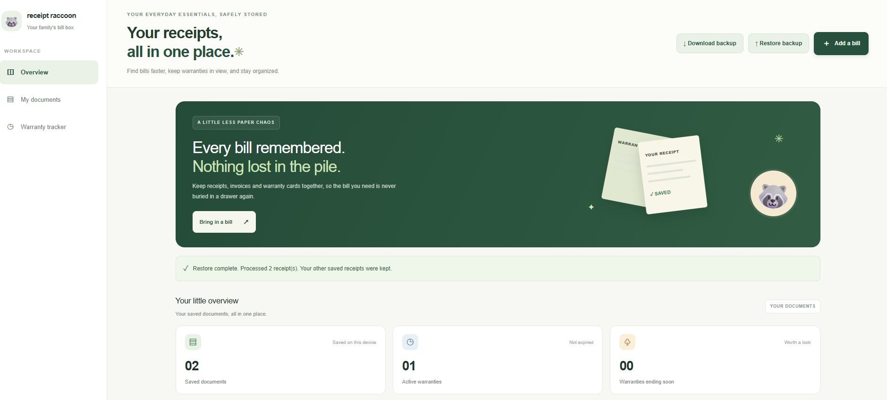
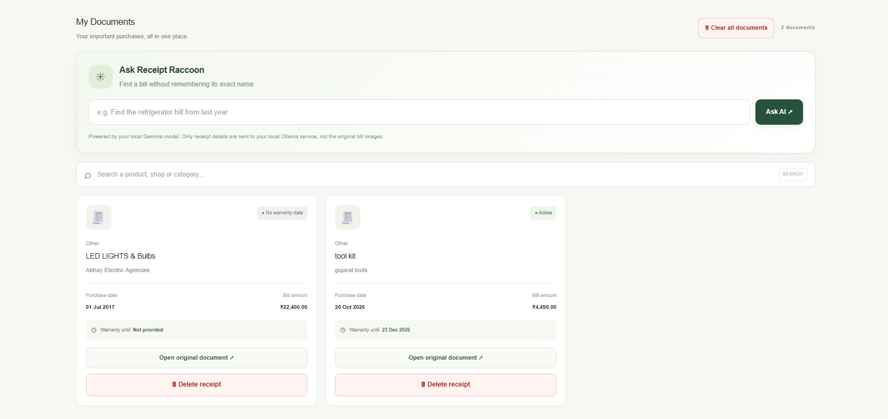
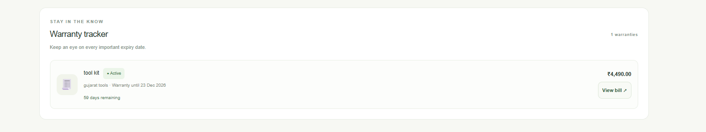

# 🦝 Receipt Raccoon

**Every bill remembered. Nothing lost in the pile.**

Receipt Raccoon is a local-first receipt and warranty organizer that helps you store bills, find old purchases, and keep track of warranty expiry dates without digging through piles of paper.

Built with Next.js, TypeScript, and open-weight AI running locally through Ollama and Gemma 3.

## 📸 Screenshots

### Dashboard
See your receipt vault at a glance.



### My Documents
Browse and search your saved bills.



### Warranty Tracker
Keep track of warranty expiry dates.



## ✨ Features

- **AI-Powered Receipt Reading:** Extract purchase information from supported receipt images and review the details before saving.
- **Ask Receipt Raccoon:** Find receipts by asking natural-language questions instead of remembering exact product names.
- **Warranty Tracker:** Keep track of warranty expiry dates and identify warranties that are ending soon.
- **Duplicate Receipt Detection:** Get a warning when a new receipt looks similar to one already saved.
- **Local Document Storage:** Store receipt records and original bill files in your browser using IndexedDB.
- **Backup and Restore:** Download a JSON backup of your receipts and restore it when needed.
- **Document Management:** Search receipts, open original documents, delete individual receipts, or clear your document collection.
- **Privacy-Focused Design:** Use a locally running AI model instead of depending on a hosted AI API for inference.

## 🌱 Why Open-Source AI?

Receipt Raccoon is built around the idea that personal documents should remain under the user's control.

Using an open-weight model through Ollama offers several advantages:

- **Privacy:** Receipt images and metadata can be processed using a locally running AI service rather than a third-party hosted AI API.
- **Local inference:** Once the model and dependencies are installed, AI features can work without an internet connection, provided the local services are running.
- **Cost control:** There are no per-request hosted AI API charges when using the local model.
- **Flexibility:** The model and inference setup can be changed to suit different machines and requirements.

The initial installation and model download require internet access. Running the application locally also requires a machine capable of running the selected model.

## 🛠️ Tech Stack

- Next.js
- React
- TypeScript
- CSS
- IndexedDB for browser-based storage
- Ollama for local AI inference
- Gemma 3 (`gemma3:4b`) for AI-powered receipt reading and natural-language receipt search

## 🚀 Getting Started

### Prerequisites

Install the following:

- [Node.js and npm](https://nodejs.org/)
- [Ollama](https://ollama.com/)

### 1. Clone the repository

```bash
git clone https://github.com/Aayush264/receipt-raccoon.git
cd receipt-raccoon
```

### 2. Install dependencies

```bash
npm install
```

### 3. Download the AI model

```bash
ollama pull gemma3:4b
```

The model download is required before using the AI features.

### 4. Start the development server

```bash
npm run dev
```

Open [http://localhost:3000](http://localhost:3000) in your browser.

Make sure Ollama is running locally and the configured model is available. If your Ollama setup requires starting the service manually, follow the [Ollama documentation](https://docs.ollama.com/).

## 📖 How to Use

1. Open Receipt Raccoon in your browser.
2. Click **Add a bill** and select a receipt image or PDF.
3. For supported images, use **Read with AI** to extract the purchase details.
4. Review the extracted information and correct anything that is inaccurate.
5. Save the bill to your local document vault.
6. Use the search box or **Ask Receipt Raccoon** to find past purchases.
7. Add warranty dates to track upcoming expirations.
8. Download a backup periodically to protect your saved records.

**Note:** AI receipt reading supports JPG, PNG, and WebP images. PDF documents can be saved with manually entered details.

## 🔒 Privacy and Data Storage

Receipt Raccoon stores receipt records and original documents in IndexedDB in the current browser on the current device.

- Your documents are not automatically synced across browsers or devices.
- Clearing browser data can remove your locally stored receipts.
- Download a backup before clearing browser storage or changing devices.
- AI features rely on the local Ollama service and the model configured by the application.

Local storage is not the same as encryption. Keep your device secure and store downloaded backups somewhere safe.

## 🧪 Production Build

To check whether the project builds successfully:

```bash
npm run build
```

To start the production build locally after a successful build:

```bash
npm run start
```

## 🎯 Project Goal

Receipt Raccoon was created for the Hacktoberfest 2026 **Slow and Steady** challenge.

The goal is simple: make an everyday chore easier using open-weight AI, local inference, and software that keeps the user's documents close at hand.

**Less paper hunting. More peace of mind.**

## 👨‍💻 Author

Created by [Ayush264](https://github.com/Aayush264).

Project repository: [github.com/Aayush264/receipt-raccoon](https://github.com/Aayush264/receipt-raccoon)
